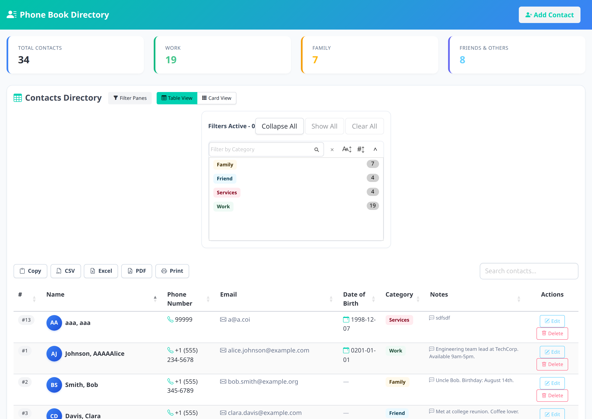
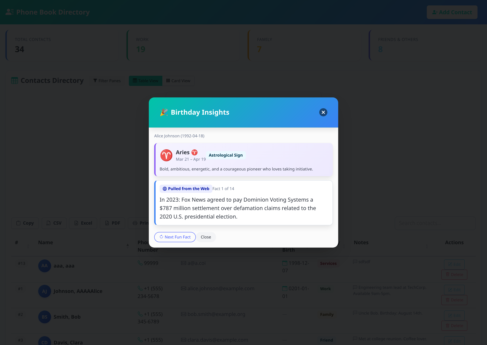

# 📞 Phone Book Web Application

A modern, responsive web application built with **Flask (Python 3)**, **MySQL**, **[Bulma CSS 1.0.2](https://bulma.io/)**, and **[DataTables.net 2.x](https://datatables.net/)**, with a modular **Playwright + Cucumber BDD** automated test suite.

---

## 📸 Application Screenshots

### 📇 Main Contacts Directory Screen
*Interactive DataTables with Bulma styling, Category SearchPanes filter, multi-format export buttons, summary stat cards, and instant search.*



### 🎂 Centered Birthday Insights Pop-up Modal
*Triggered automatically upon adding or editing contacts with a Date of Birth, featuring live web historical facts and astrological star signs.*



---

## 📁 Project Directory Structure

```text
phonebook/
├── docs/                        # Documentation and visual assets
│   └── screenshots/             # High-resolution application screenshots
├── playwright/                  # Test Suites (Playwright API + Cucumber BDD E2E)
│   ├── tests/api/               # Fast REST API & Concurrency Test Suite
│   │   ├── api-types.ts         # TypeScript interfaces for API schemas & responses
│   │   ├── contacts-crud.spec.ts # CRUD tests (/api/contacts GET, POST, PUT, DELETE)
│   │   ├── contacts-validation.spec.ts # Input validation, required fields, 400 & 404
│   │   ├── dob-facts.spec.ts    # Date facts & star sign queries (/api/dob-facts)
│   │   ├── contacts-security-boundary.spec.ts # Security, SQL injection, unicode & boundaries
│   │   └── concurrency-perf.spec.ts # 10 concurrent users (status, content integrity, SLA)
│   ├── features/                # Gherkin .feature files grouped by domain/module
│   │   ├── contacts/            # CRUD, validation, and responsive features
│   │   │   ├── crud.feature
│   │   │   ├── field_validation.feature
│   │   │   └── responsive.feature
│   │   └── birthday-insights/   # Birthday discovery & web facts feature
│   │       └── dob_facts.feature
│   ├── step-definitions/        # Step implementation files mapping to features
│   │   ├── crud.steps.ts
│   │   ├── dob_facts.steps.ts
│   │   ├── field_validation.steps.ts
│   │   └── responsive.steps.ts
│   ├── pages/                   # Page Object Model (POM) classes
│   │   ├── base.page.ts         # Shared base page object
│   │   ├── phone-book.page.ts   # Main directory & table page object
│   │   ├── add-contact-modal.page.ts # Add contact modal page object
│   │   ├── edit-contact-modal.page.ts # Edit contact modal page object
│   │   └── index.ts             # Barrel exports
│   ├── fixtures/                # Custom Playwright test and BDD fixtures
│   │   └── bdd-fixtures.ts
│   ├── support/                 # Global setup, teardown, and cucumber hooks
│   │   ├── hooks.ts
│   │   └── world.ts
│   ├── utils/                   # Reusable helper functions and API clients
│   │   └── api-helper.ts
│   ├── test-data/               # Test input data fixtures
│   │   └── contacts.json
│   ├── playwright.config.ts     # Playwright configuration file
│   ├── cucumber.js              # Cucumber configuration file
│   ├── cucumber.json            # Cucumber JSON configuration
│   ├── tsconfig.json            # TypeScript configuration
│   └── package.json             # Test dependencies and scripts
│
├── python/                      # Server-Side Application & REST API
│   ├── app.py                   # Flask REST API and web server
│   ├── db.py                    # MySQL connection management, schema initialization and migrations
│   ├── dob_facts.py             # Live Wikipedia facts engine & astrological star signs
│   ├── sample_data.py           # Initial seed contact dataset
│   ├── setup_db.sql             # MySQL database schema and seed data
│   ├── requirements.txt         # Python package dependencies
│   ├── .env.example             # Environment configuration template
│   ├── static/                  # Static assets
│   │   └── style.css            # Custom Bulma styling, card view grid, and animations
│   └── templates/               # Jinja2 HTML templates
│       └── index.html           # Bulma UI, DataTables markup, and modals
│
├── package.json                 # Root convenience scripts delegating to playwright/
├── .gitignore                   # Excludes venv, .env, node_modules, reports, caches
└── README.md                    # Project documentation
```

---

## ✨ Features

### 🎨 Bulma CSS Modern UI
- Clean, accessible interface styled with **Bulma CSS (v1.0.2)** and official DataTables Bulma integration.
- Custom stat boxes for contact category totals (*Work*, *Family*, *Friends & Others*) with hover micro-interactions.
- Accessible color contrast, responsive navbar, and smooth modal overlays.

### 🎂 Centered Birthday Insights Pop-up
When a contact is added or edited with a **Date of Birth**, a modal pop-up immediately appears in the center of the screen featuring:
1. **Live Fun Facts from the Web**: Automatically discovers interesting historical events and milestones that occurred on that date via Wikipedia's "On This Day" REST API (`/feed/onthisday/selected/{MM}/{DD}`) with offline fallback.
2. **Next Fun Fact Button**: Dynamically cycles through multiple interesting historical facts on that day without reloading the page.
3. **Astrological Star Sign Facts**: Calculates the astrological sign, symbol (♈, ♉, ♊, etc.), date range, and personality traits.

### 📅 Date of Birth Field & Validation
- Persisted in MySQL as `date_of_birth DATE NULL`.
- Fully integrated across modals (Add Contact & Edit Contact), directory table columns, child row responsive containers, and card view modes.
- Robust validation: Enforces mandatory fields (`first_name`, `last_name`, `phone_number`), validates email format, allows optional fields (`email`, `date_of_birth`, `notes`), and validates `YYYY-MM-DD` date inputs.

### ⚡ Advanced DataTables.net Features
- **SearchPanes**: Collapsible category filter section with dynamic record counts and cascading filters.
- **Card View vs Table View**: Toggle seamlessly between standard tabular layout and a responsive multi-column CSS grid card view.
- **Responsive Layout**: On mobile and narrow viewports (`< 768px`), non-essential columns gracefully collapse into an expandable child row container (`.dtr-control`), with full editing capabilities preserved.
- **Export Capabilities**: Export directory data directly to **CSV**, **Excel**, **PDF**, **Print**, or copy to **Clipboard**.
- **Real-Time Search & Sorting**: Instant multi-field searching with debouncing and column sorting.

### 🔌 RESTful API
- `GET /api/contacts`: Retrieve all contacts.
- `POST /api/contacts`: Create a new contact (validates required fields, returns contact ID, `dob_fact`, and `dob_details`).
- `PUT /api/contacts/<id>`: Update an existing contact (validates required fields, returns updated `dob_details`).
- `DELETE /api/contacts/<id>`: Delete an existing contact.
- `GET /api/dob-facts?dob=YYYY-MM-DD`: Retrieve live Wikipedia events and star sign insights for any date (validates date format).

---

## 🚀 Quick Start

### 1. Configure MySQL Credentials
Edit `python/.env` (copy from `python/.env.example` if needed):

```ini
DB_HOST=127.0.0.1
DB_PORT=3306
DB_USER=root
DB_PASSWORD=your_mysql_password
DB_NAME=phonebook_db
PORT=5000
FLASK_DEBUG=1
```

### 2. Activate Virtual Environment & Start Server

From the project root:
```bash
# Using the virtual environment
venv/bin/python python/app.py
```

Or from the `python/` directory:
```bash
cd python
../venv/bin/python app.py
```

### 3. Open in Browser
Visit **[http://localhost:5000](http://localhost:5000)** in your web browser.

---

## 🗄️ Database Architecture

The application automatically verifies and initializes the database schema and seeds initial sample records on startup:

```sql
CREATE TABLE IF NOT EXISTS `contacts` (
    `id` INT AUTO_INCREMENT PRIMARY KEY,
    `first_name` VARCHAR(100) NOT NULL,
    `last_name` VARCHAR(100) NOT NULL,
    `phone_number` VARCHAR(50) NOT NULL,
    `email` VARCHAR(150),
    `date_of_birth` DATE NULL,
    `category` VARCHAR(50) DEFAULT 'General',
    `notes` TEXT,
    `created_at` TIMESTAMP DEFAULT CURRENT_TIMESTAMP
) ENGINE=InnoDB DEFAULT CHARSET=utf8mb4 COLLATE=utf8mb4_unicode_ci;
```

SQL definitions and initial sample seed data are located in [`python/setup_db.sql`](./python/setup_db.sql) and [`python/sample_data.py`](./python/sample_data.py).

## 🧪 Automated Test Suites

The project includes two complementary automated testing suites located under `playwright/`:
1. **Playwright REST API & Concurrency Suite** (Fast HTTP-level integration, contract, validation, and 10-user concurrency tests).
2. **Cucumber BDD End-to-End Suite** (Browser automation testing Bulma UI, DataTables, modals, and responsive views).

---

### 1. REST API & Concurrency Test Suite (Playwright Test)

Located in [`playwright/tests/api/`](./playwright/tests/api/):

- **[`contacts-crud.spec.ts`](./playwright/tests/api/contacts-crud.spec.ts)**:
  - `GET /api/contacts`: Returns full contact directory with HTTP 200, validated JSON schema, and correct field types.
  - `POST /api/contacts`: Creates contacts with complete details and verifies HTTP 201, numeric ID, and returned `dob_details` with star sign and facts.
  - `PUT /api/contacts/:id`: Updates existing contact fields and verifies updated data is persisted in MySQL.
  - `DELETE /api/contacts/:id`: Deletes contact and verifies HTTP 200, removal from directory, and subsequent HTTP 404 on re-attempt.

- **[`contacts-validation.spec.ts`](./playwright/tests/api/contacts-validation.spec.ts)**:
  - Missing mandatory fields (`first_name`, `last_name`, `phone_number`) enforce HTTP 400 Bad Request.
  - Empty or whitespace-only inputs enforce HTTP 400 Bad Request.
  - Optional fields (`email`, `date_of_birth`, `notes`) can be omitted safely, defaulting category to `General`.
  - Non-existent IDs on `PUT` and `DELETE` enforce HTTP 404 Not Found.

- **[`dob-facts.spec.ts`](./playwright/tests/api/dob-facts.spec.ts)**:
  - `GET /api/dob-facts?dob=YYYY-MM-DD`: Verifies star sign calculation, astrological symbols (♈, ♋, ♑, etc.), personality traits, formatted dates, and historical facts.
  - Rejects missing, empty, or malformed `dob` parameters with HTTP 400 Bad Request.
  - Rejects invalid calendar dates (e.g. `2024-02-31`) with HTTP 400 Bad Request.

- **[`contacts-security-boundary.spec.ts`](./playwright/tests/api/contacts-security-boundary.spec.ts)**:
  - **Date of Birth Validation**: Rejects invalid format (`not-a-date`) and invalid calendar dates (`2025-02-31`) on both POST and PUT with HTTP 400 Bad Request.
  - **Length Boundary Enforcement**: Enforces VARCHAR(100) name limits with HTTP 400 Bad Request.
  - **SQL Injection Defense**: Parameterized queries safely store injection payloads (`Robert'); DROP TABLE contacts;--`, quotes, apostrophes) literally as strings without SQL errors or data loss.
  - **Unicode & UTF-8**: Full `utf8mb4` fidelity verification for international names (`Zoë 🌺`, `Müller-Świętochowski`, Arabic, Japanese).
  - **XSS Script Preservation**: Safe transmission and storage of `<script>` tags in JSON without script execution.

- **[`concurrency-perf.spec.ts`](./playwright/tests/api/concurrency-perf.spec.ts)** (10 Concurrent Users Performance & Integrity):
  - **10 Concurrent Readers**: Fires 10 simultaneous `GET /api/contacts` requests; asserts HTTP 200, identical contact counts, matching record IDs, zero data corruption, and sub-second execution.
  - **10 Concurrent Writers**: 10 simultaneous users submit unique contacts; asserts HTTP 201, 10 unique IDs (zero auto-increment collisions), accurate star signs, and verifies all 10 records are persisted in MySQL.
  - **10 Concurrent Independent User Sessions**: 10 parallel user pipelines executing Create -> Read Facts -> Update -> Verify Update -> Delete -> 404 check concurrently without cross-user interference.
  - **Latency SLA Benchmarking**: Measures Min, Max, Average, and P95 latency across concurrent requests (enforces < 350ms average latency SLA).

---

### 2. Browser E2E BDD Suite (Cucumber + Playwright)

Located in [`playwright/features/`](./playwright/features/):

- **[`crud.feature`](./playwright/features/contacts/crud.feature)**: Directory loading, adding/editing contacts, browser delete confirmation dialog handling.
- **[`dob_facts.feature`](./playwright/features/birthday-insights/dob_facts.feature)**: Centered Birthday Insights modal display, web facts cycling, and star signs.
- **[`field_validation.feature`](./playwright/features/contacts/field_validation.feature)**: UI modal form validation, column headers, and optional fields.
- **[`responsive.feature`](./playwright/features/contacts/responsive.feature)**: Mobile responsive collapsing child rows (`500x800`) and CSS grid Card View.

---

### 🚀 Running the Tests

You can run test suites from the project root or from inside `playwright/`:

```bash
# Run BOTH suites (API tests + Cucumber E2E tests)
npm test

# Run ONLY the fast Playwright API & Concurrency tests (~2 seconds)
npm run test:api

# Run ONLY the Cucumber browser BDD suite
npm run test:e2e

# Run browser tests with visible browser window
npm run test:headed

# Generate & view HTML reports
npm run test:report         # Cucumber HTML report
npm run test:api:report     # Playwright API HTML report
```
